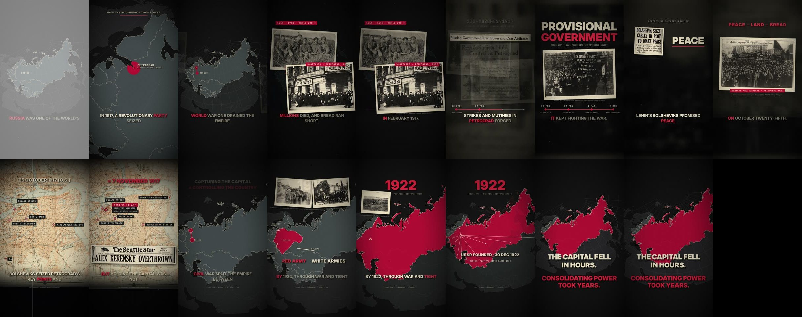

# Verification report

Produced by `src/verify.py` on `output/how_the_bolsheviks_took_power_2160x3840_60fps.mp4` (the 4K master).

| Check | Result | Detail |
|---|---|---|
| resolution 2160x3840 | PASS | 2160x3840 |
| frame rate 60 | PASS | r=60/1 avg=60/1 |
| video codec H.264 | PASS | h264 High level 52 |
| pixel format yuv420p | PASS | yuv420p |
| duration 55-65 s | PASS | 64.500 s |
| audio codec AAC | PASS | aac LC 48000 Hz 2 ch 249 kbps |
| audio/video length match | PASS | audio 64.490 video 64.500 |
| frame count = duration x 60 | PASS | 3870 frames |
| moov atom first (faststart) | PASS |  |
| integrated loudness -14 +-1 LUFS | PASS | -14.0 LUFS |
| true peak <= -1 dBTP | PASS | -1.5 dBFS |
| no clipped audio samples | PASS | max 0.842 |
| A/V sync at opening impact (|offset| < 50 ms) | PASS | visual flash 0 ms, audio transient 1 ms |
| no black frames inside the film | PASS | 0 found |
| no frozen frames (duplicate consecutive frames) | PASS | 0 frames with ~zero motion |
| no unexplained visual jumps | PASS | median motion 0.89, 99.5th pct 8.44, unexplained jumps at frames [] |

File size: 680.8 MB.

Frame-level continuity scan: every frame of the film was decoded at 135×240 and compared with its neighbour. Scene boundaries use a 0.3 s dissolve and in-scene phase changes fade the outgoing layer, so no frame-to-frame step above the threshold remains outside the intended hard accents (the opening flash and the impact flashes at 0.9 s and 1.6 s).

Contact sheet of the finished file (each scene's first frame and mid-point, and the last frame): `docs/verify_contact_sheet.jpg`.

## Not verified by machine

* How the narration *sounds* (voice quality and prosody): needs a human listen.
* Playback inside the Shorts / Reels apps (interface overlays): check on a phone.
* The legal status of the archive items in your jurisdiction: see `docs/SOURCES.md`.
